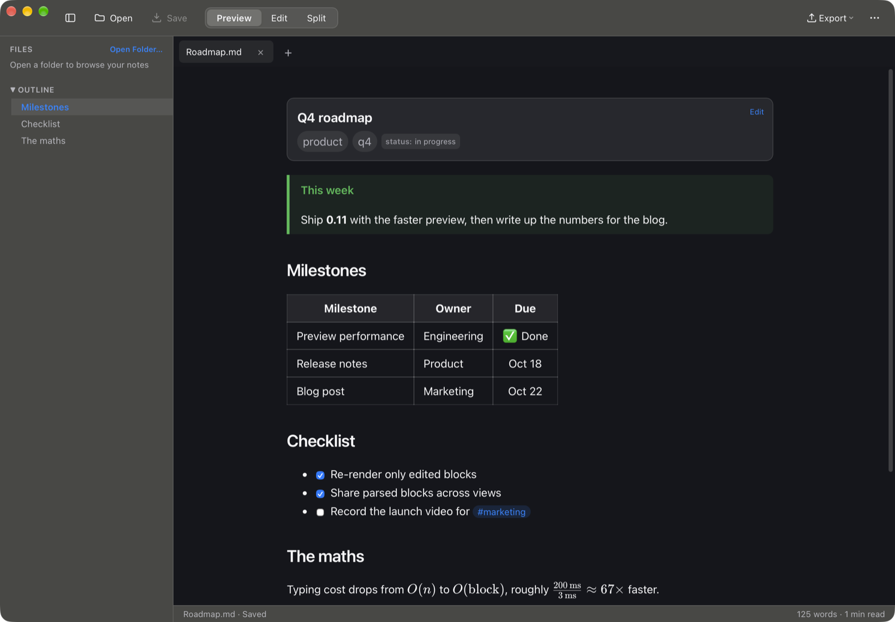

<p align="center">
  
</p>

<p align="center"><em>Pass Go, straight to preview.</em></p>

<p align="center">
  <a href="https://github.com/appoly/markappoly/releases/latest"></a>
  <a href="https://github.com/appoly/markappoly/wiki"></a>
  
  <a href="LICENSE"></a>
</p>

# Markappoly

A desktop app that opens Markdown files and shows them formatted, the way they're meant to look. Double-click a `.md` and you're reading it, not staring at raw `#` and `*`. When you do need to change something, one key flips you into an editor and back.

It's built with Tauri and React, so the download is small and it feels like a real Mac app rather than a web page in a window. Windows and Linux builds come from the same code.

## Screenshot

<p align="center">
  
</p>

## Download

Grab the installer for your platform from the [latest release](https://github.com/appoly/markappoly/releases/latest):

On **macOS**, download the `.dmg`, open it, and drag Markappoly into Applications. The build is signed and notarized by Apple, so it opens without security warnings.

On **Windows**, download and run the `.msi`.

On **Linux**, download the `.AppImage` (make it executable, then run it) or install the `.deb`.

After the first launch the app keeps itself up to date: when a new version ships it asks before downloading, then restarts into the new one.

## Features

**Reviewing changes**

Markappoly remembers the version of each file you last read. When a file changes somewhere else (an AI agent rewrites a plan, a teammate's edit arrives with `git pull`), it shows you what moved:

- Changed and added passages are highlighted in the formatted preview, with a marker where text was removed. Hover a change to see what it said before. In Edit and Split view the changed lines are marked in the editor too, and F7 moves the cursor from change to change
- A review bar sums it up ("4 changes in 3 sections"), steps through each change (F7 / ⇧F7), opens a source diff, and clears the highlights with **Mark as reviewed**
- The outline puts a dot beside every section with unreviewed changes
- Select any passage to **comment** on it. Comments are kept per file and follow their passage when the file changes
- **Copy feedback** turns your comments into Markdown, with each section name and quoted passage, ready to paste back to the author or an agent
- Turn it off in Settings (**Highlight outside changes**) if you'd rather not track changes

**Reading**
- Formatted preview by default, with GitHub-flavored Markdown: tables, task lists, strikethrough
- Syntax-highlighted code, **KaTeX math**, **Mermaid diagrams**, and GitHub-style alerts (`> [!NOTE]`)
- Outline sidebar (with scroll spy) and folder tree browser, find-in-document (⌘F), and search — or search **and replace** — across a whole folder
- Open Recent, word count and reading time, live reload when the file changes on disk
- Session restore: tabs, folder, and each document’s view mode come back when you relaunch
- Cursor, undo history, and reading position stay with each tab while you work
- A resizable sidebar with collapsible outline, bookmarks, and backlinks, plus a welcome screen with recent files
- With the sidebar closed, a compact heading rail tracks your place in Preview; hover or click it to jump between sections, or use Tab and Enter
- Adjustable reading width, font, and line spacing, plus your own custom CSS, and an option to block remote images
- YAML frontmatter chrome (title, tags, date) above the preview
- Relative Markdown links open sibling notes as tabs, and `guide.md#install` lands on the heading. Links to source files open in a highlighted, line-numbered code view (`main.rs#L42` jumps to the line); PDFs, images and office files open in their default app
- **Back / Forward** (⌘[ / ⌘], or your mouse's side buttons) between documents and sections
- The folder tree updates as notes are created, renamed, or deleted by other tools
- **Compare** two open files side by side as a diff
- **Present mode** (⌘⇧P): turn the document into slides, split on `---`

**Notes and linking**

Point Markappoly at a folder of notes (an Obsidian vault works as-is) and it behaves like a knowledge base:

- `[[Wiki links]]` jump between notes by name; type `[[` in the editor and it autocompletes from the folder
- A **backlinks** panel in the sidebar shows every note that links to the one you're reading, with the line it came from
- `![[Note]]` embeds a whole note into the preview; `![[Note#Section]]` embeds just that section
- `#tags` render as clickable chips, in the text and in frontmatter. Click one to search the folder for it
- Hover any internal link and a small rendered preview of the target pops up
- **Quick switcher** (⌘P): fuzzy-find any file, type `>` for commands, `#` for tags, or `@` for headings in the current document
- **Graph** (⌘⇧G): the current note's neighbourhood, or flip to **Vault** for a force-directed map of every note
- **Templates**: keep skeleton notes in a `Templates` folder and create new notes from them (⌘N) with `{{title}}`, `{{date}}` and `{{time}}` filled in
- **Daily notes** (⌘⇧D): jump to today's note, created on first use — name a template `Daily` to seed it
- **Bookmarks** (⌘D) pin your most-used files to the top of the sidebar
- Frontmatter is editable as **properties**: typed fields that write themselves back as YAML
- More preview syntax: `==highlights==`, `%%comments%%` that stay hidden, foldable callouts (`> [!note]-`), and Obsidian's extra callout types (info, question, danger, and friends)

**Editing**
- Toggle to a CodeMirror source editor with grouped Heading and Insert menus and contextual table tools, or a **split view** (⌘⇧E) with editor and preview side by side, scrolling together
- **Focus mode** and **typewriter scrolling** for distraction-free writing, with editor spellcheck
- Table tools to insert, extend, and align Markdown tables
- Paste or drag an image to attach it next to the document; paste rich text and it converts to Markdown
- Tick a checkbox in the preview and it writes the change back to the source
- Optional **autosave**, and **File History**: a snapshot of every file is kept before each save (and before folder-wide replaces), diffable and restorable from the File menu

Save status and failures are visible, closing offers **Save / Don’t Save / Cancel**, and reloading asks before discarding edits. If a file changes externally, saving asks before replacing the disk version; **Save a copy** offers another way to keep your work.

Everything’s tunable from **Settings** (⌘,), with reading preferences first. Occasional actions such as Graph, Present, File History, Reload, and zoom live in the **More** menu.

**Export:** Text, HTML, JSON (AST), **Word (.docx)**, and PDF, plus **Copy as HTML** for pasting rich text elsewhere. Exports match the preview: HTML is a single self-contained file (images inlined, diagrams as SVG, math that renders offline), Word keeps callouts, highlights, images, diagrams and equations, and PDF waits for diagrams and fonts before printing. With [Pandoc](https://pandoc.org) installed, also RTF, EPUB, LaTeX, and Pandoc-rendered Word and PDF.

**Native polish:** frosted vibrancy on macOS and acrylic on Windows, system/light/dark themes, a native menu bar, drag-and-drop, "open with" file association, and a window that reopens where you left it. On macOS, a **Quick Look** extension renders Markdown when you press Space on a `.md` file in Finder.

For a walkthrough of every feature, see the **[user manual](https://github.com/appoly/markappoly/wiki)**.

## Keyboard shortcuts

| Action | Shortcut | Action | Shortcut |
| ------ | -------- | ------ | -------- |
| Open | ⌘O | Find | ⌘F |
| Open folder | ⌘⇧O | Quick switcher | ⌘P |
| New note | ⌘N | Daily note | ⌘⇧D |
| Save | ⌘S | Toggle edit/preview | ⌘E |
| Reload from disk | ⌘R | Split view | ⌘⇧E |
| Bookmark | ⌘D | Present | ⌘⇧P |
| Toggle sidebar | ⌘\ | Graph | ⌘⇧G |
| Bold / Italic / Link | ⌘B / ⌘I / ⌘K | Zoom | ⌘+ / ⌘- / ⌘0 |
| Settings | ⌘, | New tab / Close | ⌘T / ⌘W |
| Back / Forward | ⌘[ / ⌘] | Next / previous change | F7 / ⇧F7 |

## Command line

Choose **Install Command Line Tool…** from the Markappoly menu to get a `markappoly` command, much like VS Code's `code`:

```bash
markappoly notes.md              # open a file
markappoly a.md b.md             # open several files as tabs
markappoly docs/                 # open a folder in the sidebar
markappoly guide.md#install      # open a file at a heading
claude -p "draft a plan" | markappoly   # show piped output, live as it streams
markappoly - < draft.md          # read stdin explicitly
markappoly --help
```

Paths are relative to the directory you run it from. If Markappoly is already open, the files open as tabs in the existing window instead of starting a second copy, and your prompt comes straight back. Piped text is saved to a temporary file (cleared after a week) that updates as more input arrives, so you can watch an agent's or a build's output form.

Where it installs:
- **macOS:** a link in `/usr/local/bin` to the script inside `Markappoly.app` (you'll be asked for your password unless that folder is already writable). If you decline, it goes in `~/.local/bin`. You can also link it yourself: `ln -s /Applications/Markappoly.app/Contents/Resources/cli/markappoly /usr/local/bin/markappoly`.
- **Linux:** `~/.local/bin/markappoly`, pointing at the AppImage or installed binary.
- **Windows:** `markappoly.cmd` in `%LOCALAPPDATA%\Markappoly\bin`, added to your user `PATH`. Open a new terminal afterwards.

## Build from source

For contributors. You'll need **Node 18+**, **Rust** (via [rustup](https://rustup.rs)), and your platform's [Tauri prerequisites](https://tauri.app/start/prerequisites/).

```bash
npm install
npm run tauri dev      # run the app with hot reload
npm run tauri build    # produce a native installer for your OS
```

**[DISTRIBUTION.md](DISTRIBUTION.md)** covers signing, notarization, the app icon, auto-updates, and the daily security-audit release. **[SECURITY.md](SECURITY.md)** is the vulnerability-reporting policy.

**Stack:** React + TypeScript + Vite · Tauri v2 (Rust) · unified/remark/rehype · CodeMirror 6 · KaTeX · Mermaid · `remark-docx`

## License

[MIT](LICENSE) © Appoly Ltd

---

<p align="center"><sub>Built by Appoly · "Do not pass Go, just preview your markdown."</sub></p>
